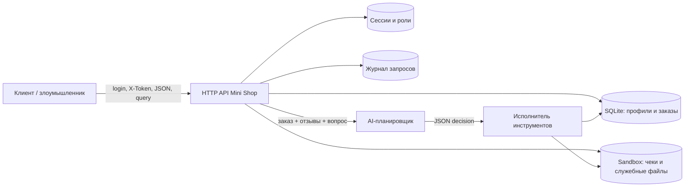

# Модель угроз Mini Shop

## Границы и компоненты

Сервис работает локально на `127.0.0.1`. Пользовательский клиент обращается к HTTP API.
Сервер содержит сессионную авторизацию, SQLite с профилями и заказами, временное
файловое хранилище чеков, журнал запросов и AI-планировщик, который формирует решение
для помощника. Решение планировщика передаётся серверному исполнителю инструментов.

Границы доверия проходят между клиентом и API, между API и AI-планировщиком, а также
между решением планировщика и исполнителем. Любые query-параметры, JSON-поля,
заголовки, отзывы и ответ модели считаются недоверенными.

## Активы и требования

| Актив | Требование |
|---|---|
| Профили, адреса и email | Конфиденциальность; доступ только владельцу или staff |
| Заказы и чеки | Конфиденциальность и целостность; клиент видит свои данные |
| Цены каталога | Целостность; цена вычисляется сервером |
| Токены и пароли | Конфиденциальность; не попадают в ответы и логи |
| Отзывы и HTML-страница | Безопасный вывод; текст не исполняется как JavaScript |
| Файлы sandbox | Конфиденциальность, целостность и ограниченная доступность |

## Матрица угроз и защит

| ID | Угроза и сценарий | Воздействие | Защита и проверка |
|---|---|---|---|
| T1 | SQL-инъекция через `id`, `q` или `order_id` | Чтение чужих данных, обход фильтров | Параметризованные запросы и строгая проверка числовых ID; PoC с `OR 1=1` возвращает ошибку или пустой scoped-результат |
| T2 | IDOR профиля или заказа | Клиент читает данные другого клиента | Владелец берётся из серверной сессии; проверяются `/profile`, `/orders` и `/assistant/context` |
| T3 | Неавторизованный список заказов | Массовая утечка заказов | Требуется `X-Token`; customer получает только свои заказы, staff — все |
| T4 | Подмена `X-Role` | Эскалация до staff | Роль берётся только из сессии; `/admin/export` с одним `X-Role` возвращает 403 |
| T5 | Подмена цены в заказе | Покупка дешевле каталога | Цена игнорируется от клиента и берётся из `products`; проверка отправляет `price: 1` |
| T6 | Path traversal и чтение чужого файла | Утечка чеков или служебной заметки | Customer получает только свой `receipt.txt`; запрещены `/` и `..`; staff проверяется отдельно |
| T7 | Утечка логов | Компрометация паролей и токенов | `/debug/logs` только для staff, секреты редактируются; проверка без токена и с staff |
| T8 | XSS в отзывах | Выполнение JavaScript у посетителя | `html.escape` при выводе; проверка `<script>` не должна появиться в HTML как тег |
| T9 | Prompt injection через отзыв или вопрос | Модель может предложить чужой файл, экспорт или удаление | Контекст не даёт полномочий; ответ модели сохраняется до/после, а серверный guardrail проверяется принудительной передачей опасного JSON |
| T10 | Опасные AI-инструменты | Чтение чужих файлов, экспорт данных, удаление дерева | `/assistant/execute` авторизует каждую операцию по серверной роли и владельцу; PoC отправляет изготовленные решения напрямую |
| T11 | Ошибочная область действия файлов | Клиент подменяет `user` в query | Для customer путь строится по пользователю сессии, а не по query; проверка `user=bob` возвращает чек Alice |

## Остаточные риски и допущения

Стенд использует синтетические данные и привязан к localhost, поэтому модель не покрывает
сетевое TLS, внешнюю доставку данных и продакшен-хранилище секретов. Защита AI должна
оставаться серверной: system prompt снижает риск prompt injection, но не заменяет
проверки в `/assistant/execute`. В production также потребовались бы безопасное хранение
паролей, ротация токенов, CSRF-защита и ограничение размера/частоты запросов.
